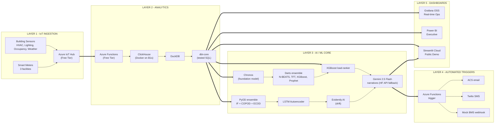

# WattWise AI — Project Blueprint

**Smart Energy Management Platform · IMPACT pSiddhi 3.0 · Topic S4-I-14**

> **From invoice-driven energy management to AI-powered, real-time optimization.**

| | |
|---|---|
| **Topic ID** | S4-I-14 |
| **Semester** | 4 — Integration Mastery (Capstone) |
| **Program** | IMPACT pSiddhi 3.0 · pSiddhi-2026-01 |
| **Budget Ceiling** | ₹2,500 (planned spend ₹1,650, buffer ₹850) |
| **Status** | ✅ L&D Approved · ▶ **Week 4 — Build Phase 1, Day 1** |
| **Deploy Target** | Microsoft Azure (Free Tier, end-to-end) |

This document is the single source of truth for the WattWise AI build. It is aligned with the approved proposal `WattWise_AI_Proposal_S4-I-14.docx` and the RFP `S4-I-14.docx`. Work from this file for the next 14 weeks; show it to L&D at every checkpoint.

---

## 1. Project Overview

WattWise AI is a **5-layer, AI-core, Azure-deployed smart energy management platform** that ingests IoT telemetry from smart meters and building sensors, processes it through a high-performance analytics engine, applies machine learning to forecast demand / detect anomalies / manage peak load, automatically triggers optimization actions, and surfaces everything through real-time dashboards with plain-language AI recommendations.

The thesis is a **closed optimization loop**:

> **Ingest** IoT consumption → **Analyze** in real time → **Forecast & Detect** with ML → **Auto-Intervene** via serverless triggers → **Explain** in plain English.

The platform shifts energy management from reading last month's invoice to receiving a 30-second alert *before* a peak threshold is crossed — with an AI-generated explanation of why and a ranked plan of what to do — all inside the ₹2,500 ceiling.

---

## 2. The Problem

Energy is one of the largest *controllable* operating costs in commercial and industrial facilities, yet it is managed reactively. Telemetry exists but is locked in vendor-proprietary systems that cannot be cross-queried or fed to an optimizer. Four compounding gaps:

1. **No real-time consumption visibility** — anomalies are discovered days/weeks late, when the bill arrives. Corrective levers (load shift, HVAC setback, equipment service) are gone by then.
2. **Invoice-based, reactive management** — a failing chiller drawing 2× nameplate kW for three weeks costs three weeks of waste before anyone sees the line item.
3. **Unmanaged peak demand charges** — utilities bill peak kW separately from kWh; this is **30–40% of a commercial bill**. Without proactive monitoring, every spike permanently raises the next billing-period base.
4. **No forward-looking AI** — demand forecasting, load-shed ranking, and anomaly explanation need ML that current SCADA/BMS deployments don't have.

---

## 3. End-to-End Architecture

Five layers, every component on Azure Free Tier or open-source:

| Layer | Responsibility | Key Services |
|---|---|---|
| **1 · IoT Ingestion** | Collect telemetry from meters & sensors | Azure IoT Hub (Free), paho-mqtt device simulators |
| **2 · Analytics** | Store + transform time-series at minute grain | ClickHouse, DuckDB, dbt-core |
| **3 · AI / ML Core** | Forecast, detect anomalies, rank loads, narrate | Chronos, Darts, PyOD, LSTM-AE, XGBoost, Evidently, Gemini |
| **4 · Automated Triggers** | Act on AI signals automatically | Azure Functions (Free), ACS email, Twilio SMS, mock BMS webhook |
| **5 · Dashboards** | Visualize for ops, exec, and demo audiences | Grafana OSS, Power BI Desktop, Streamlit Cloud |

### Architecture Diagram



### One-Line Data Flow

`Smart meters & sensors → IoT Hub (Free) → Azure Functions (Free) → ClickHouse + DuckDB + dbt → ML core (Chronos+Darts / PyOD+LSTM-AE / XGBoost / Evidently) → Gemini (HF fallback) → Grafana + Power BI + Streamlit + automated triggers`

---

## 4. Technology Stack

| Layer | Technologies | Tier | Cost |
|---|---|---|---|
| Language | Python 3.11, SQL | — | Free |
| IoT Ingestion | Azure IoT Hub, paho-mqtt simulator | Free tier | Free |
| Storage | ClickHouse (Docker), DuckDB, Azure Blob | Free tier / OSS | Free |
| Serverless | Azure Functions | Free tier | Free |
| Forecasting | Chronos (foundation model), Darts (N-BEATS, TFT, XGBoost, Prophet) | OSS | Free |
| Anomaly | PyOD (IF + COPOD + ECOD), TensorFlow/Keras (LSTM-AE) | OSS | Free |
| Peak Mgmt | XGBoost load-ranking regressor | OSS | Free |
| ML Tooling | Optuna, MLflow, Evidently AI, PyCaret | OSS | Free |
| Analytics Eng | dbt-core | OSS | Free |
| Training Env | Google Colab (T4 GPU) | Free tier | Free |
| AI Narratives | Gemini 2.5 Flash + Hugging Face Inference API + Ollama (local dev) | Free tier / OSS | Free |
| Dashboards | Grafana OSS, Power BI Desktop, Streamlit Cloud | OSS / Free | Free |
| API | FastAPI, Uvicorn | OSS | Free |
| Data Validation | Great Expectations | OSS | Free |
| QA | Pytest, Pytest-cov, Locust, Selenium | OSS | Free |
| CI/CD | GitHub Actions | Free | Free |
| Alerting | Azure Communication Services (email), Twilio (SMS) | Free / PAYG | ₹400 (SMS optional) |
| Monitoring | Azure Monitor | Free tier | Free |

### ⚠️ Python 3.11, not 3.14

This project pins **Python 3.11**. TensorFlow/Keras, Prophet, and PyTorch (Chronos backbone) do not yet publish stable wheels for Python 3.14 (released Oct 2025). 3.11 is the universally-supported version for the ML ecosystem in 2026. Python 3.14 remains installed on the machine for other use; this project isolates 3.11 via a venv.

### Training vs Inference Split

- **Training** (Chronos fine-tune, Darts ensemble, LSTM-AE, XGBoost) runs on **Google Colab free tier** (12 GB RAM, T4 GPU). Artefacts export to Azure Blob.
- **Inference** runs on the **Azure B1s VM** (1 vCPU / 1 GB RAM) via a lightweight FastAPI service.
- **Ollama** runs on the developer laptop only (the 8B model exceeds B1s RAM). Production LLM fallback is the cloud-hosted Hugging Face Inference API.

---

## 5. Repository Structure

```
wattwise-ai/
├── PROJECT_BLUEPRINT.md      # this file — the master end-to-end document
├── README.md                 # repo intro + quickstart
├── requirements.txt          # all Python 3.11 dependencies
├── docker-compose.yml        # ClickHouse + Grafana + Ollama services
├── .gitignore
├── .env.example              # template for API keys & connection strings
├── ingestion/                # IoT simulators + Azure IoT Hub device clients
├── analytics/                # ClickHouse schema, dbt project, DuckDB queries
├── ml/                       # forecasting / anomaly / peak-ranking
│   └── notebooks/            # Colab training notebooks
├── triggers/                 # Azure Functions app
├── dashboards/
│   ├── grafana/              # Grafana provisioning (datasources, dashboards)
│   └── streamlit/            # Streamlit demo app
├── api/                      # FastAPI inference service
├── tests/
│   ├── unit/                 # pytest unit tests
│   ├── integration/          # pipeline integration tests
│   └── e2e/                  # end-to-end scenario tests
├── infra/                    # Azure provisioning (az CLI / Bicep)
├── data/
│   └── seed/                 # UCI / ASHRAE / OpenEI reference datasets
├── docs/                     # architecture, model cards, runbook, QA report
└── .github/workflows/ci.yml  # CI pipeline (lint + pytest + coverage gate)
```

| Folder | Purpose | Built in |
|---|---|---|
| `ingestion/` | Device simulators, IoT Hub clients, telemetry schema | Wk 4–5 |
| `analytics/` | ClickHouse DDL, dbt models, DuckDB pre-aggregation | Wk 6, 11 |
| `ml/` | All ML models + training notebooks | Wk 7–8, 11, 13 |
| `triggers/` | Azure Functions event handlers | Wk 13 |
| `dashboards/` | Grafana, Power BI, Streamlit | Wk 6, 12, 15 |
| `api/` | FastAPI model inference service | Wk 8, 14 |
| `tests/` | All test suites | every week |
| `infra/` | Azure resource provisioning scripts | Wk 4, 15 |
| `data/` | Seed datasets for training | Wk 4 |
| `docs/` | Documentation + evidence | Wk 9, 16 |

---

## 6. Data Model — 3 Energy Domains

### Unified Telemetry Schema

Every reading, regardless of source, normalizes to:

```
{
  facility_id:   string   # "office" | "warehouse" | "datacentre"
  device_id:     string   # unique per device
  device_class:  string   # main_meter | sub_meter | hvac | lighting | occupancy | weather
  domain:        string   # consumption | demand | cost
  timestamp:     datetime # UTC, minute grain
  value:         float
  unit:          string   # kWh | kW | INR
  metadata:      json      # rate_plan, zone, nameplate_kw, etc.
}
```

### The 3 Energy Domains (RFP minimum: 3)

| Domain | Unit | Description |
|---|---|---|
| **Consumption** | kWh | Energy used over an interval |
| **Demand** | kW | Instantaneous/rolling power draw — drives peak charges |
| **Cost** | ₹ (INR) | ToU-rate-aware monetary value of consumption |

### Facilities × Device Classes (3 × 6)

| | main_meter | sub_meter | hvac | lighting | occupancy | weather |
|---|---|---|---|---|---|---|
| **Office** | ✓ | ✓ | ✓ | ✓ | ✓ | ✓ |
| **Warehouse** | ✓ | ✓ | ✓ | ✓ | ✓ | ✓ |
| **Data Centre** | ✓ | ✓ | ✓ | ✓ | ✓ | ✓ |

### Seed Datasets (for realistic model training)

| Dataset | Use |
|---|---|
| UCI Individual Household Electric Power Consumption | Base load shapes, forecasting train data |
| ASHRAE Great Energy Predictor III | Multi-building consumption patterns |
| OpenEI Commercial Reference Building Load Profiles | Facility-type-specific demand curves |

---

## 7. AI/ML Specification

AI is the **engine**, not a label. Remove it and the product does not function.

### 7.1 Demand Forecasting
- **Tier 1 — Chronos** (Amazon OSS foundation model, Apache-2.0): zero-shot forecasts on day one, no training.
- **Tier 2 — Darts ensemble**: N-BEATS + Temporal Fusion Transformer + XGBoost + Prophet, per-facility, 90-day history, 24h-ahead hourly. **Optuna** tunes; **MLflow** tracks.
- **Target:** MAPE ≤ 8% on held-out test set.

### 7.2 Consumption Anomaly Detection (3-stage cascade)
- **Stage 1 — PyOD ensemble** (Isolation Forest + COPOD + ECOD, 3-way vote): flag candidates.
- **Stage 2 — LSTM Autoencoder** (Keras): confirm via reconstruction error.
- **Stage 3 — Evidently AI**: confirm it's a real anomaly, not input drift.
- **Target:** F1 ≥ 0.88 on labelled test set.

### 7.3 Peak Demand Management
- Rolling 15-min demand monitor + Chronos/Darts forecast.
- When predicted peak > 90% of threshold, an **XGBoost load-ranking regressor** scores controllable loads by `f(deferrability, demand_contribution_kW, comfort_impact, response_time)` and emits an explainable top-N shed sequence.

### 7.4 Optimization Narrative
- **Gemini 2.5 Flash** turns ML outputs into plain-English recommendations.
- **Hugging Face Inference API** = cloud fallback; **Ollama + Llama 4 Scout 8B** = local dev fallback.

### The 3 Mandated AI Scenarios → Technique

| RFP Scenario | ML technique |
|---|---|
| Peak demand | Chronos + Darts forecast + XGBoost load-ranker |
| Anomalous consumption | PyOD (IF+COPOD+ECOD) → LSTM-AE → Evidently |
| Optimization opportunity | k-means on hourly load shapes + per-cluster efficiency baselines + Gemini rationale |

---

## 8. The 5 Dashboard Views (RFP minimum: 4)

| # | View | Surface | Contents |
|---|---|---|---|
| 1 | Real-Time Consumption | Grafana | Live kWh tiles per facility, drilldown to sub-meter |
| 2 | Demand Pattern Analysis | Grafana | 15-min rolling demand, peak threshold band, forecast overlay |
| 3 | Cost Analysis | Power BI | ₹ by facility/domain, ToU costing, month-to-date projection |
| 4 | AI Optimization Intelligence | Streamlit + Power BI | Anomaly feed, Gemini narratives, peak-shave recommendations |
| 5 | Cross-Facility Benchmarking *(bonus)* | Power BI | kWh per sq.ft, normalized energy intensity |

---

## 9. Build Sequence (Weeks 4–17)

### ▶ Current Position: **Week 4, Day 1**

### Phase 1 — Weeks 4–9: Foundation + Ingestion + Analytics + Initial AI

| Week | Task | Deliverable | QA Gate |
|---|---|---|---|
| **Wk 4** | Azure setup, IoT Hub, B1s VM, ClickHouse Docker, repo + CI scaffold, telemetry schema | Infra ready, schema published | Schema validation unit tests |
| Wk 5 | Smart-meter + sensor simulators (3 facilities). Ingest **consumption + demand** | 2 domains ingesting E2E | Integration tests: simulator → IoT Hub → ClickHouse |
| Wk 6 | dbt cubes (1-min/15-min/hourly). Grafana **Real-Time Consumption + Demand Pattern** views | 2 dashboard views live | dbt test 100%, render tests |
| Wk 7 | Train **PyOD anomaly ensemble**. MLflow. Validate F1 | Anomaly model ≥ 0.88 F1 | Model accuracy suite |
| Wk 8 | **Chronos** baseline + **Darts** ensemble + Optuna. Backtest | Forecast MAPE ≤ 8% | Forecast accuracy + backtest harness |
| Wk 9 | Bug bash, mid-term docs, Moodle upload, demo rehearsal | Mid-term package ready | Phase-1 regression suite green |

### 🏁 Week 10 — Mid-Term Review (all must be ✅)
- [ ] IoT Hub ingestion operational
- [ ] Analytics for ≥2 domains (consumption + demand)
- [ ] Dashboard with ≥2 views
- [ ] Initial AI model trained (PyOD + Chronos/Darts)
- [ ] Unit tests passing
- [ ] Mid-term docs on Moodle

### Phase 2 — Weeks 11–16: Cost Domain + Full AI + Triggers + Scale + Deploy

| Week | Task | Deliverable | QA Gate |
|---|---|---|---|
| Wk 11 | Add **Cost** domain (ToU via dbt). **LSTM-AE** + **Evidently** drift | 3rd domain + LSTM-AE + drift dashboard | Cost unit tests, LSTM-AE accuracy, Evidently nightly |
| Wk 12 | Cost Analysis + AI Optimization views. Streamlit dashboard | 4 views (RFP min hit) | Cross-browser UI tests, drilldown |
| Wk 13 | **XGBoost load-ranker**. Azure Functions triggers. Mock BMS webhook | Closed-loop triggers firing | Trigger correctness E2E |
| Wk 14 | Gemini narratives. HF API fallback. ACS + Twilio alerts | Narratives + alerts working | Narrative validation, fallback path tests |
| Wk 15 | Cross-Facility Benchmarking (5th view). Locust load test 1,000 meters. Deploy hardening | Scale validated, deployed | Load tests, deployment smoke tests |
| Wk 16 | Final docs, diagrams, demo video, deck. Final Moodle upload | Final package ready | Full regression + ≥80% coverage report |

### 🏆 Week 17 — Final Review Demo Script
1. Live IoT ingestion (3 facilities × 6 device classes)
2. All 3 domains end-to-end
3. All 5 dashboard views with drilldown
4. Live anomaly injection → PyOD → LSTM-AE → Evidently → trigger → Gemini → alert (~30s)
5. 24h demand forecast vs actuals, MAPE ≤ 8%
6. Peak-shave recommendation with explainability
7. Month-to-date cost projection per facility
8. QA evidence: green CI, ≥80% coverage, Locust at 1,000 meters
9. Documentation walkthrough on Moodle

**Effort:** ~150 hrs over 12 weeks (~12.5 hrs/week). QA embedded weekly.

---

## 10. Local Development Setup

### Verified Toolchain (this machine)

| Tool | Version | Status |
|---|---|---|
| Python 3.11 | 3.11.9 | ✅ |
| Python 3.14 | 3.14.0 | ✅ (not used here) |
| Git | 2.51.2 | ✅ |
| Docker Desktop | 28.3.0 | ✅ (⚠️ start it — service stopped) |
| Azure CLI | 2.82.0 | ✅ |
| Azure Functions Core Tools | 4.12.0 | ✅ |
| Node.js | 22.19.0 | ✅ |
| VS Code | 1.123.2 | ✅ |
| Power BI Desktop | 2.144.x | ✅ |
| Azure Storage Explorer | installed | ✅ |
| Azure IoT Explorer | installed | ✅ |

### Bootstrap Commands

```powershell
# 1. Start Docker Desktop (currently stopped)
Start-Process "C:\Program Files\Docker\Docker\Docker Desktop.exe"

# 2. Create the Python 3.11 virtual environment
cd "c:\Users\arunn.thiayagarajan\Psiddhi\sem 4\wattwise-ai"
py -3.11 -m venv .venv
.\.venv\Scripts\Activate.ps1

# 3. Install dependencies
pip install --upgrade pip
pip install -r requirements.txt

# 4. Start local infra (ClickHouse + Grafana + Ollama)
docker compose up -d

# 5. Copy env template and fill in keys
Copy-Item .env.example .env
```

### SaaS Accounts Checklist

- [ ] **Microsoft Azure** (free tier) — https://azure.microsoft.com/free
- [ ] **GitHub** — https://github.com/signup
- [ ] **Google AI Studio** (Gemini key) — https://aistudio.google.com
- [ ] **Hugging Face** (Inference API token) — https://huggingface.co/join
- [ ] **Streamlit Community Cloud** — https://share.streamlit.io
- [ ] **Twilio** (SMS demo) — https://www.twilio.com/try-twilio

---

## 11. Azure Resources (Cloud Footprint)

All on Free Tier. Total committed cloud cost: **₹0**.

| Service | Purpose | Tier |
|---|---|---|
| Azure IoT Hub | Telemetry ingestion | Free (8K msgs/day) |
| Azure Functions | Serverless triggers | Free (1M exec/mo) |
| Azure B1s VM | Hosts ClickHouse + Grafana + FastAPI inference | Free (750 hrs/mo) |
| Azure Blob Storage | Telemetry archive + model artefacts | Free (5 GB) |
| Azure Communication Services | Email alerts | Free (250/day) |
| Azure Monitor | Observability + budget alerts | Free tier |

### Provisioning Order (Week 4)
1. `az group create` — resource group
2. `az iot hub create` — IoT Hub (F1 free SKU)
3. `az vm create` — B1s VM (Ubuntu)
4. `az storage account create` + container — Blob
5. `az functionapp create` — Functions app
6. `az monitor` — budget alert at **₹1,200**

> **Cost guardrail:** Azure Cost Management budget alert fires at ₹1,200 (well below the ₹2,500 ceiling). B1s VM stopped nightly.

---

## 12. QA Strategy

QA is **mandatory** and embedded weekly. CI runs on every push. The 4 RFP-mandated areas each own a suite.

| Test Type | Covers | Tool | Target |
|---|---|---|---|
| Unit | Schema, normalization, ToU calc, trigger logic, feature eng | Pytest + Pytest-cov | ≥ 80% coverage |
| Analytics Transform | Every dbt model (unique, not_null, accepted_values, freshness) | dbt test | 100% models tested |
| Integration | Simulator → IoT Hub → Function → ClickHouse → DuckDB | Pytest + Testcontainers | All 3 domains green |
| E2E | Anomaly → AI → trigger → alert; Forecast → dashboard | Pytest + Selenium | 5 scenarios |
| Model Accuracy | Anomaly F1 ≥ 0.88; Forecast MAPE ≤ 8%; LSTM-AE ROC-AUC ≥ 0.90 | scikit-learn harness | All targets met |
| ML Production Quality | Data/prediction/target/correlation drift | Evidently AI | Drift report green nightly |
| Data Validation | Schema compliance, null/dup, gap detection | Great Expectations | Zero invalid records |
| Load | 1,000 meters × 5-min over 1 hr | Locust | < 2s p95 ingest latency |
| Trigger Correctness | Fires on anomaly events, not on normal | Pytest + fixtures | ≥ 95% precision/recall |
| Regression | All of the above on every push | GitHub Actions | 100% pass to merge |

### AI-Assisted QA
- **Synthetic data** — Gemini generates edge-case telemetry (sensor drift, missing intervals, ToU boundaries).
- **Drift detection** — Evidently nightly on rolling production-replay data.
- **Regression analysis** — MLflow compares model outputs commit-over-commit.

---

## 13. Budget Tracking

| | Amount |
|---|---|
| Ceiling | ₹2,500 |
| Planned spend | ₹1,650 (Twilio ₹400 + domain ₹450 + Azure overage buffer ₹800) |
| Buffer | ₹850 |
| **Spent so far (Week 4)** | **₹0** |

> Only paid lines are optional SMS, optional demo domain, and a reserved Azure overage buffer (contingency, not committed). Core platform is 100% free tier / OSS.

---

## 14. RFP Requirement → Implementation Map

The proof-of-completeness table. Every RFP requirement maps to a concrete component.

| RFP Requirement | Delivered By | Status |
|---|---|---|
| Handle ≥3 energy domains (consumption, demand, cost) | `ingestion/` schema + `analytics/` dbt | ⬜ Wk 5, 11 |
| Monitoring dashboard ≥4 views | `dashboards/` (5 views) | ⬜ Wk 6, 12, 15 |
| Automated optimization actions on AI events | `triggers/` Azure Functions | ⬜ Wk 13 |
| AI/ML core across 3 scenarios | `ml/` (forecast, anomaly, peak) | ⬜ Wk 7–8, 11, 13 |
| Deploy on Azure end-to-end | `infra/` + all Azure services | ⬜ Wk 4, 15 |
| Operate within ₹2,500 | Section 13 budget tracking | ✅ Planned ₹1,650 |
| QA covering ingestion/analytics/triggers/AI quality | `tests/` + CI | ⬜ every week |
| QA coverage ≥80% | Pytest-cov gate in CI | ⬜ enforced |
| Working POC/demo by Week 17 | Section 9 demo script | ⬜ Wk 17 |
| Demand forecasting validated | `ml/` Chronos+Darts, MAPE ≤8% | ⬜ Wk 8 |
| Mid-term (Wk 10) deliverables | Section 9 checkpoint | ⬜ Wk 10 |
| Suggested tools used | IoT Hub, ClickHouse, DuckDB, Power BI, Functions, Gemini, Ollama, sklearn, MLflow, PyCaret | ✅ all in stack |

---

## 15. Definition of Done

### Week 10 — Mid-Term DONE when:
- IoT Hub ingestion operational ✓
- ≥2 domains analyzed ✓
- ≥2 dashboard views live ✓
- Initial AI model trained (PyOD + Chronos/Darts) ✓
- Unit tests passing ✓
- Mid-term docs on Moodle ✓

### Week 17 — Final DONE when:
- 3+ domains, 5 dashboard views, 3 AI scenarios live ✓
- Demand forecasting validated (MAPE ≤8%) ✓
- Automated triggers tested ✓
- Azure deployment live ✓
- QA suite ≥80% coverage ✓
- Live demo + all evidence on Moodle ✓

---

## 16. Next Immediate Actions

**Starting now (Week 4, Day 1):**

1. ▶ **Start Docker Desktop** (it's installed but stopped)
2. ▶ **Scaffold complete** — this repo is initialized
3. ⬜ **Create Python 3.11 venv + install requirements** (`py -3.11 -m venv .venv` → `pip install -r requirements.txt`)
4. ⬜ **Sign up for Azure free tier** + provision the first IoT Hub
5. ⬜ **Build the first smart-meter simulator** (`ingestion/`) and confirm one message lands in IoT Hub

---

*This blueprint is aligned with `WattWise_AI_Proposal_S4-I-14.docx` (approved) and `S4-I-14.docx` (RFP). Update the status markers and the budget "spent so far" line as the build progresses.*
